# Solo Leveling: Life OS — System Architecture Document
**Version:** 50.0 Master Life OS  
**Architecture Model:** Local-First • Offline-First • Zero-Paid Infrastructure  
**Author / Principal:** Hadi Essam (هادي عصام)  
**Timezone Standard:** Africa/Cairo (UTC+2)  

---

## 1. Architectural Philosophy & Guiding Principles

1. **Absolute Free-Stack Guarantee:**
   - 0 paid APIs, 0 cloud subscription fees, 0 mandatory external databases.
   - Core compute, storage, rendering, and logic execute 100% inside the client browser.
   - Any external synchronization (e.g. JSONBin, Supabase Free Tier) is strictly an optional backup layer that never blocks runtime operations.

2. **Zero Progress Loss & Data Sovereignty:**
   - Authentic user progress (Level 21, 8028+ XP, 28-day streak, 438+ completed quests, 10 shadow soldiers, 36 certifications, Bassem School 357 lessons, expenses ledger) is immutable.
   - No update or migration may reset, overwrite, or downgrade user progress.

3. **High-Performance Dual-Tier Storage:**
   - **Tier 1 (Synchronous Fast Cache):** `localStorage` (`soloV6`) loads state synchronously in `< 1ms`, completely eliminating blank-screen or Level 1 flash states during boot.
   - **Tier 2 (High-Capacity Durable Store):** `IndexedDB` (`solo_leveling_db`) runs concurrently for high-capacity state, rolling auto-snapshots (up to 20 restore points), and SHA-256 integrity verification.

---

## 2. Component Architecture Diagram

```mermaid
flowchart TD
    subgraph UI_Layer["User Interface & Experience (Cyber Dark RPG)"]
        CC["System Command Center (What to do right now?)"]
        HUD["RPG Player HUD (Level 21, 8028+ XP, HP/Mana)"]
        CP["Command Palette (Ctrl+K Omnisearch)"]
        MNAV["Mobile Bottom Navigation (5 Core Touchpoints)"]
        DIAG["Diagnostics & Self-Repair Modal"]
    end

    subgraph Core_Engine["Core System & Event Loop"]
        CLK["SystemClock (Africa/Cairo UTC+2)"]
        EVT["SystemEvents Bus (Decoupled Pub/Sub)"]
        VAL["State Validator & Deterministic Migration (v50)"]
        ERR["safeRender Error-Isolation Boundaries"]
    end

    subgraph Logic_Engines["Progression & Game Mechanics"]
        XP["XpEngine (Anti-Duplication Mutex + Audit Ledger)"]
        TASK["TaskEngine (Unified Schema Normalization & Cairo Rollover)"]
        BASSEM["BassemEngine (357 Lessons / 14 Phases Raid Boss)"]
    end

    subgraph Life_OS_Modules["Life OS Domain Subsystems"]
        HLTH["HealthSystem (BMI 167cm, Workouts, Sleep, 0-100 Recovery Score)"]
        CRER["CareerSystem (Riyadh/Jeddah Pipeline, Interview Arena, Portfolio HQ)"]
        PLAN["PlannerSystem (Time Blocker, Cascading Goals, Multi-Cadence Reviews)"]
        FIN["FinanceSystem (Runway Months, Saudi Relocation Fund 100% Cleared)"]
        BRN["SecondBrain (Notes, ADR Decision Log, Failure-to-Wisdom Rules)"]
    end

    subgraph Storage_Tier["Dual-Tier Local-First Storage"]
        SYNC_CACHE[("localStorage 'soloV6' (<1ms Fast Sync Cache)")]
        IDB[("IndexedDB 'solo_leveling_db' (Snapshots, Durability, Integrity Checksum)")]
        SW["Service Worker (Cache: solo-leveling-v50-life-os-master)"]
    end

    UI_Layer --> Core_Engine
    Core_Engine --> Logic_Engines
    Logic_Engines --> Life_OS_Modules
    Life_OS_Modules --> Storage_Tier
```

---

## 3. Subsystem Breakdown

### 3.1 Core Storage Manager (`core_storage.js`)
- **Dual-Storage Synchronization:** Automatically writes to both `localStorage` and `IndexedDB`.
- **Auto-Snapshots:** Maintains up to 20 rolling point-in-time snapshots with automatic pruning.
- **SHA-256 Checksums:** Cryptographic digest ensures state files cannot be corrupted by truncated disk writes.
- **Full JSON Backup Export/Import:** Native client-side file picker and stream download with pre-import inspection.

### 3.2 Core System Clock & Event Bus (`core_system.js`)
- **Cairo Timezone Enforcement (`Africa/Cairo`):**
  - Daily rollover, streak calculations, and time-block scheduling strictly follow Cairo midnight rather than unpredictable user machine time.
- **Decoupled System Events:**
  - Standardized event bus (`XP_GRANTED`, `LEVEL_UP`, `TASK_TOGGLED`, `STATE_REPAIRED`, `ROLLOVER_COMPLETE`).
- **Safe Render Wrappers:**
  - Any single component failure is caught, isolated, and rendered with a recovery alert, preventing blank screen crashes.

### 3.3 Authoritative XP Engine (`core_xp.js`)
- **Anti-Duplication Mutex Lock:** Prevents rapid double-clicks on buttons from duplicating XP within 600ms.
- **Streak Multiplier Curve:** Mathematical scaling `min(1.5, 1 + (streak / 200) * 0.5)` rewards consistency up to +50% at 100+ day streaks.
- **500-Transaction Immutable Ledger (`S.xpLedger`):** Every XP collection or reversal is logged with timestamp, date, domain stat, source, and running balance.

### 3.4 Unified Task Engine (`core_tasks.js`)
- **Schema Normalization:** Unifies intelligent quests, recovery mode tasks, habit routines, Notion-style projects, and Bassem daily training under a single deterministic API.
- **Anti-Spam Toggle Mutex:** Protects task checkboxes against rapid UI clicks.
- **Centralized Daily Rollover:** Handles midnight task resets and streak evaluation safely without data loss.

### 3.5 Specialized Life OS Subsystems
- **Health & Fitness (`life_health.js`):**
  - Calibrated to Hadi's height (167 cm) for exact BMI calculation.
  - Workout logging with sets, reps, and exercise volume.
  - Sleep duration & quality tracking combined into a 0–100 Recovery Score.
- **Career & Job Hunt HQ (`life_career.js`):**
  - Riyadh & Jeddah target agency pipeline with status progression (`Identified`, `Targeted`, `Outreach`, `Interviewing`, `Offer`).
  - Interview Arena with performance marketing question bank (Meta Ads scaling, CAPI, attribution, crisis diagnostics).
  - Portfolio HQ documenting Turkish TL 171K spend and 11,406 leads generated.
- **Time & Goal Planner (`life_planner.js`):**
  - 8 color-coded focus blocks tailored to Hadi's daily 4+ hours available time.
  - Cascading Goal Hierarchy from Life Vision -> Yearly -> Quarterly -> Monthly milestones.
  - Multi-cadence review system (Daily, Weekly, Monthly, Quarterly, Yearly) awarding reflective XP.
- **Finance & Liquid Runway (`life_finance.js`):**
  - Monthly fixed overhead vs variable spend calculator.
  - Liquid savings runway in months and days.
  - Saudi Relocation Fund milestone tracker (100% Saved & Cleared).
- **Second Brain, ADRs & Lessons Learned (`life_brain.js`):**
  - Playbook notes with full-text search and tag filtering (`#Meta Ads`, `#Saudi Relocation`, `#English`).
  - Architectural Decision Records (ADRs) tracking Context, Options, Choice, Expected vs Actual Outcome.
  - Failure-to-Wisdom Lesson Database rewarding +25 XP for documenting mistakes and establishing immutable preventive rules.

### 3.6 System Command Center & Navigation (`ui_command_center.js`, `ui_command_palette.js`, `ui_diagnostics.js`)
- **Deterministic Next Best Action Engine:** Evaluates Cairo time-of-day, incomplete priorities, energy level (High / Medium / Low), and boss urgency to give ONE clear directive with a `[START NOW]` button.
- **Command Palette (`Ctrl+K`):** Global keyboard-accessible omnisearch across all tabs, quests, Bassem chapters, certifications, notes, and quick actions.
- **Mobile-First Bottom Navigation Bar:** Fixed bottom bar on viewports `<= 768px` for ergonomic one-thumb operation.
- **Diagnostics Panel:** Complete transparency into storage size, player state integrity, SW version, and one-click self-repair.

---

## 4. Security & Privacy Model

- **Zero Hardcoded Secrets:**
  - Removed all hardcoded master keys and tokens from the repository.
  - If optional cloud sync is enabled by the user, keys are saved solely in client-side `localStorage`.
- **Offline Reliability:**
  - Service Worker (`sw.js`) network-first caching ensures the site loads instantly even when completely disconnected from the internet.
- **PWA Ready:**
  - Full Web App Manifest (`manifest.json`) allows home screen installation on iOS and Android.
